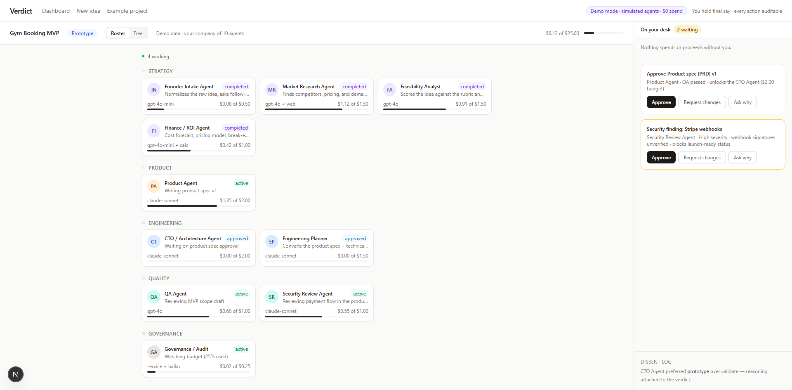
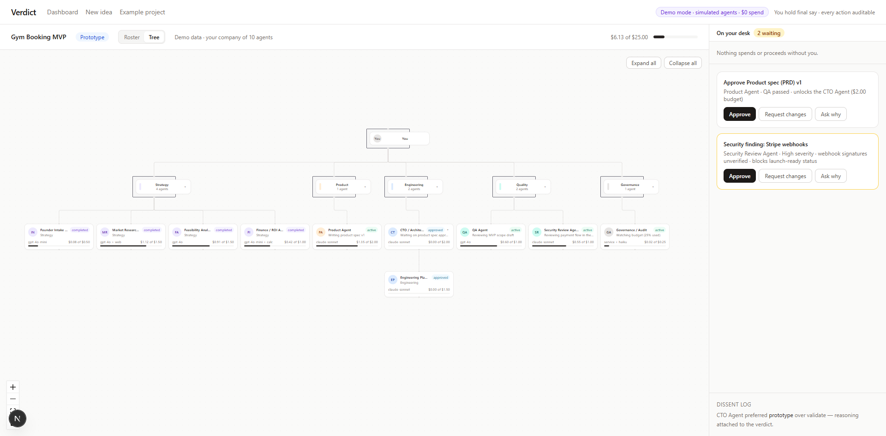

# Verdict

[](https://github.com/Jamal-Akhras/Verdict/actions/workflows/ci.yml)

A multi-agent orchestration platform built on one rule: **agents propose, humans govern.** Agent teams execute as a dependency DAG under human approval gates, per-agent budgets, and an append-only audit trail. Packaged as a product: an AI CTO that assesses whether a software idea is worth building, then hands your AI coding tools an exact, reviewed plan to build it.



The command center: agent teams grouped by function, each running under its own model and budget, with an approval inbox on the right. High-risk steps wait on the desk until the founder decides, and every action is auditable.



## Architecture

- **Task orchestrator** — dependency-DAG execution with failure isolation and per-agent budget enforcement; runs orphaned by process restarts are recovered rather than lost.
- **Approval gates** — the PRD and tech plan pause the run until the founder approves; a denial cancels downstream work. A QA agent reviews the PRD and a Security Review agent audits the tech plan, with high/critical findings raising acknowledgement requests.
- **Model router** — task-, risk- and cost-aware routing across OpenAI, Anthropic and Gemini with fallback, pre-spend estimation, and write-ahead CostEvent/ModelCall logging: every model call is recorded before it happens.
- **Audit** — append-only audit and cost ledgers, full artifact provenance, per-agent and per-model spend, an activity timeline with filters and CSV export, and 80% budget warnings.

## Safety boundaries

- Agents start in Observe/Suggest; high-risk actions gate on human approval. No black-box outputs.
- Prompt-injection defence: untrusted web content is neutralised before entering fenced context blocks, and user-derived input is fenced with injection-guard instructions.
- Multi-tenant isolation and rate limiting are enforced by tests (`test_multitenancy.py`, `test_limits_proxy.py`, `test_security.py`).

## Evaluation

Prompt changes are validated like code changes: `apps/api/scripts/quality_pass.py` scores golden test briefs on verdict accuracy and flip rate across repeated runs, gated by a pass threshold that fails the change. See `docs/QUALITY_PASS.md`.

## Why a custom orchestrator

Deliberate architecture decision — owning the failure modes (stale runs, crash recovery, budget enforcement) was the point. The trade-offs are written up in `docs/adr/0001-custom-orchestrator-over-langgraph.md`.

## Layout

- `apps/web` — Next.js 15 frontend (dashboard, project command tree, live run view)
- `apps/api` — FastAPI backend (models, orchestrator, model router, agents)
- `seeds/agent_templates` — the v0 agent template definitions
- `docs/adr` — architecture decision records

## Run locally

```bash
# 1. Database
docker compose up -d db

# 2. API (Python 3.12)
cd apps/api
pip install -e ".[dev]"          # or: uv sync
cp .env.example .env
alembic upgrade head
uvicorn app.main:app --reload    # http://localhost:8000/docs

# 3. Web
cd apps/web
pnpm install
pnpm dev                         # http://localhost:3000
```

**No API keys?** The app boots in demo mode: the complete flow with realistic canned agent outputs and zero AI spend. Add a free Gemini key for real model calls, still at no cost. See `docs/ZERO_COST.md`.

## Status

In active development. Demo mode ships the full product flow with labeled simulated costs; no deployment or user numbers are claimed.

## Non-negotiables

No black-box outputs. Append-only audit/cost ledgers. Write-ahead cost logging. High-risk actions gate on human approval. Agents start Observe/Suggest.
